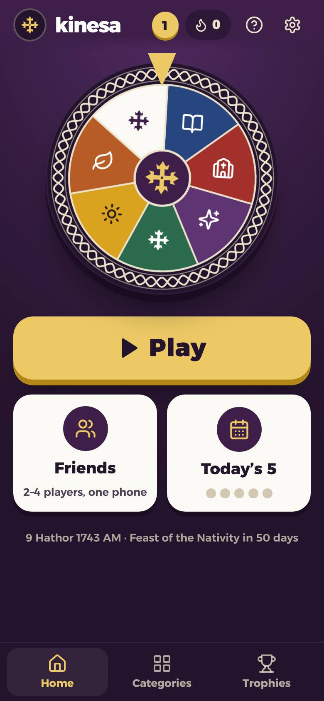
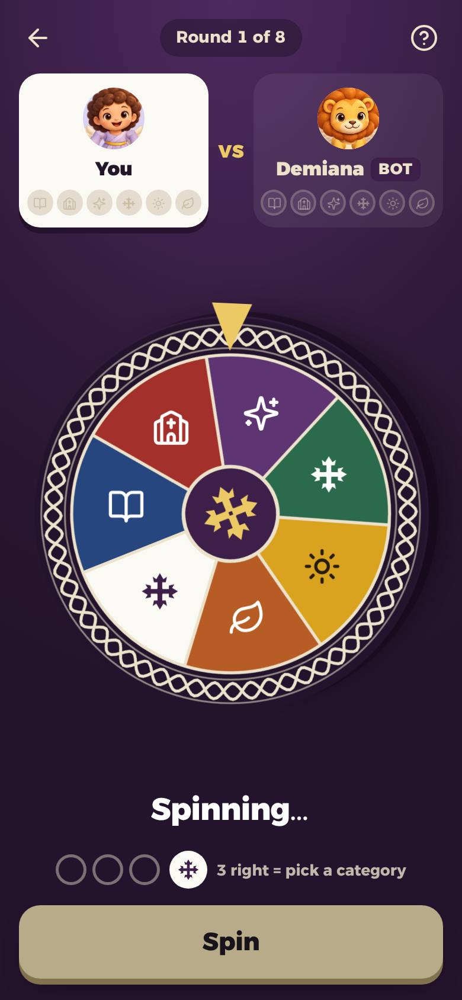
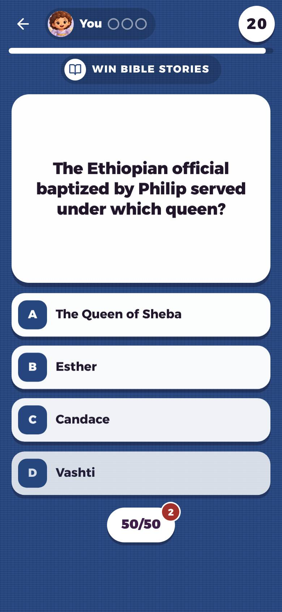
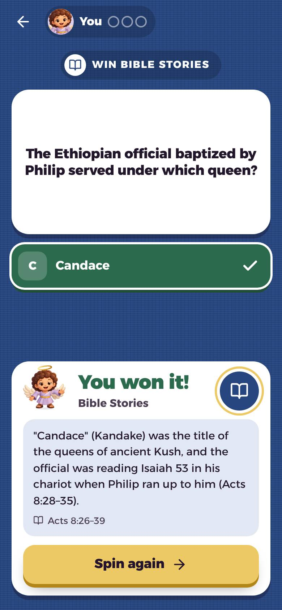
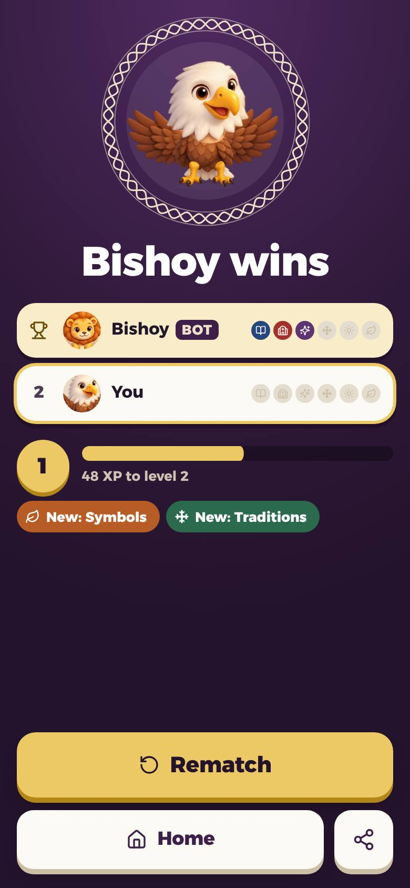

Live UI playground: https://kinesa-playground.kerollos-lowandy.chatgpt.site

# Kinesa ✦

A Coptic and Bible trivia game for teens and adults. Spin the wheel, keep going while you're right, and win all six categories: against a practice bot, with up to four friends on one phone, or in a daily five. Its look is woven from Coptic tapestry.

| Home                               | Spin                                 | Question                                   | Reveal                                       | Results                                  |
| ---------------------------------- | ------------------------------------ | ------------------------------------------ | -------------------------------------------- | ---------------------------------------- |
|  |  |  |  |  |

[The Big Spin](video/), a 30-second film starring the four companions, made with the same character code the app uses.

## Run locally

Node.js 20.19+ or 22.12+ is required; Node.js 24 is recommended.

```sh
npm ci
npm run dev
```

Open the address printed by Vite. To build and serve the production version:

```sh
npm run build
npm run preview
```

Deploy `dist/` to any static host at the origin root. The app uses hash navigation and needs no routing rewrites or API keys. Categories (`#categories`) and Trophies (`#collection`) support direct links; unfinished games resume from Home.

## The experience

- **Play:** one tap starts a game against a practice bot. Spin the seven-panel wheel (six categories plus the cross), answer, and keep your turn while you're right. Every three right answers, or landing on the cross, earns a **pick**: choose a category and answer a harder question to win it. Win all six first (three in **Quick** games). A wrong answer passes the turn; the bot plays instantly and its turn is replayed as a quick summary. Games save and resume from Home.
- **50/50:** twice a game, remove two wrong answers.
- **Friends:** 2–4 players on one phone, same rules, with a full-screen pass-the-phone cover between turns. Setup is just names, game length and level.
- **Today's 5:** five daily questions from five categories, the same for everyone on a date, with a day streak and streak freezes (earned every seven days, up to two).
- **Categories:** six category cards; each plays ten questions against practice bots.
- **Trophies:** level and XP, games, wins, right answers, day streak, and Bronze (5) / Silver (15) / Gold (30) per category. One category a week earns 1.5× XP.
- **Every answer teaches:** the reveal shows a short explanation and its source.
- **Coptic calendar:** Home shows today's Coptic date and the current or next feast, fast or season.
- **Companions:** Leo the lion (Mark), Lou the ox (Luke), Juno the eagle (John) and Mattie the human (Matthew) are dealt at random each game. They are flat 2D cartoon characters drawn in code (`src/companions/`): one-piece shapes with cel shading and a thin outline, so no joint can ever separate. They wave on the pass-the-phone screen, cheer on a right answer, droop on a miss and dance when someone wins. They are fictional companions inspired by the traditional Gospel symbols, not portraits of the evangelists.
- **Accessible by default:** keyboard answers (A–D or 1–4), visible focus, AA text with a 13px floor, 40px+ touch targets, reduced-motion paths, sound off by default (Settings), vibration only when sound is on.

More screens: [pick a category](docs/redesign/v2/pick.jpg) · [bot turn](docs/redesign/v2/bot-turn.jpg) · [wrong answer](docs/redesign/v2/reveal-wrong.jpg) · [pass the phone](docs/redesign/v2/handoff.jpg) · [friends setup](docs/redesign/v2/friends-setup.jpg) · [categories](docs/redesign/v2/categories.jpg) · [trophies](docs/redesign/v2/trophies.jpg) · [how to play](docs/redesign/v2/how-to-play.jpg) · [daily results](docs/redesign/v2/daily-results.jpg)

## The look: Akhmim tapestry

The visual world comes from Coptic woven tunics (Akhmim tapestry): a purple-dyed field behind everything, six dyes for the categories (woad, madder, purple, green, weld, ochre) that fill each question screen, white and linen cards for reading, a roundel wheel with a twelve-point Coptic cross at its hub, chunky pressable buttons, and Alexandria lettering. There is no glass and no gold. See `DESIGN.md` for the system and `PRODUCT.md` for the audience, tone and content rules.

## Questions

The bank lives in `src/content/questions.json`: 125 source-noted questions, at least 20 per category, each with a difficulty, four options, one answer, an explanation and a verifiable source. `npm run validate:questions` (also part of `npm test`) checks unique ids, exactly four distinct options, a single valid answer, explanations, sources and the per-category minimum.

Questions that need a subject-matter check wait in `src/content/review-queue.json` and never ship until they are reviewed and moved into the bank.

## Frontend scope

This is a local-first app, not an online service. Practice play uses bots; friends play on one device. There are no accounts, remote rooms or backend. Saved games (version 2: classic games, quick rounds, and older turn-based saves, migrating version 1), progress, preferences and the daily streak live in browser local storage and stay on the device. The classic rules live in `src/classic.js` (pure functions, unit-tested in `tests/classic.test.js`).

## Verification

```sh
npm test                      # question validator + unit tests
npx playwright install chromium
npm run test:e2e              # browser tests (KINESA_PORT overrides port 5173)
npm run play-through          # plays classic, friends, daily and category games at 390×844 and 1280×800
npm run build
```

`npm run play-through` saves a screenshot of every phase to `test-results/play-through/`, probes 360px and 390px layouts for overflow and small text, and fails on any console error. Before-and-after screens for this redesign are in `docs/redesign/`.

## App Store

`capacitor.config.ts`, `resources/` (icon and splash sources) and `docs/STORE-CHECKLIST.md` prepare a Capacitor iOS wrapper for "Coptic Trivia". Privacy and support URLs are placeholders in `src/appInfo.js`. Nothing has been built for iOS.

## Credits

Original Kinesa artwork and interface; plays in the friendly category-wheel trivia genre, with no assets, names or art from any existing game. React 19, Vite, and Lucide icons (ISC). Alexandria is bundled under the SIL Open Font License in `public/fonts/`.

Earlier designs: [first redesign](docs/redesign/after/) · [before the redesigns](docs/redesign/before/)

The companion film lives in `video/` (see its README); it builds from the same `src/companions/model.js` as the app.
