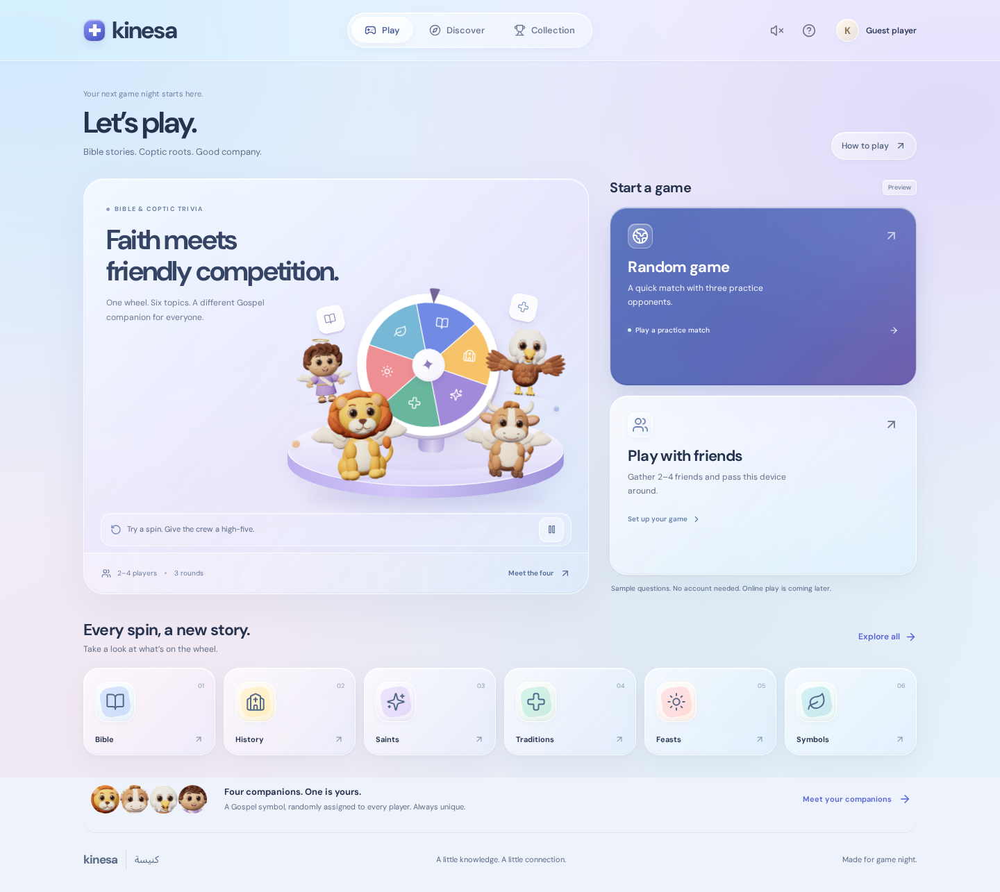

# Kinesa ✦

A Coptic and Bible trivia game frontend for up to four players, with animated Gospel companions and a clean, colorful interface.



## Run locally

Node.js 20.19+ or 22.12+ is required; Node.js 24 is recommended.

```sh
npm ci
npm run dev
```

Open the address printed by Vite. To build and serve the production version:

```sh
npm run build
npm run preview
```

Deploy `dist/` to any static host at the origin root. The app uses in-memory navigation and needs no routing rewrites or API keys.

## The experience

- **Random game:** enter a name, preview matchmaking with three explicitly labeled practice bots, reveal the companions, and play. Bots spin and answer on their own turns; the player advances after reading each explanation. Bot points do not inflate the player's collection.
- **Play with friends:** preview creating a room for two to four people or joining a room. Fill the seats, then deal companions and play locally. The sample join code is `AMEN24`; the most recently created room code also works in this browser. These preview codes do not connect separate devices.
- **Random companion assignment:** players never choose their Gospel figure. Each new match uses a fresh Fisher–Yates shuffle of the lion, ox, eagle, and human, dealing without replacement. There can be no duplicate companions in a match. Rematches shuffle again.
- **Guided setup:** a three-step indicator explains setup, companion reveal, and play. Desktop setup includes an illustrated rules panel, with a compact layout on phones.
- **Animated reveal:** each player's companion appears on a flipping card before gameplay begins. Card colors follow the companion's identity. Players can return to edit the roster, then deal a new set before starting.
- **Interactive game scene:** a softly shaded lavender stage, floating book and cross tokens, character high-fives, a practice wheel, and distinct idle movement for the four companions. Reduced-motion preferences disable the ambient movement and shorten the practice spin.
- **Mobile-first entry:** both game modes appear above the illustrated arena on phones; the mobile navigation dock hides during room setup and matches so it cannot crowd the reveal or cover answers.
- **Clear turn handoffs:** pass the device to the named player, confirm readiness, then spin. A segmented round indicator and phase-aware player status keep the turn clear.
- **Saved match:** unfinished matches survive refresh, including the same companions, scores, question, selected answer, and handoff state. The home screen shows the active companion, current turn, and round with a direct resume action. Invalid saves are rejected.
- **Keyboard controls:** answer with A–D or 1–4 when a human question is active; shortcuts ignore text fields and dialogs.
- **Complete local match:** six-category wheel, questions, explanations, 100 points per correct answer, three rounds per player, shared wins, and rematches.
- **Collection:** local category badges, correct-answer totals, and completed-match counts. Sound is optional and off by default.
- **Refined visual system:** sans-serif typography, light surfaces, violet actions, softly dimensional illustration, and consistent styling across rooms, assignment cards, questions, and collections.
- **Responsive interface:** desktop navigation, a mobile game dock, keyboard-operable dialogs, visible focus, and reduced-motion support.

The original Gospel-symbol companions are **Leo the lion / Mark**, **Lou the ox / Luke**, **Juno the eagle / John**, and **Mattie the human / Matthew**. They are fictional companions inspired by traditional Gospel symbols, not portraits of the evangelists.

## Frontend scope

This edition is an interactive **frontend preview**, not a live multiplayer service. Random matchmaking uses bots; friends play on one device. Online matchmaking, real remote rooms, invitations, accounts, and backend persistence are not implemented. The interface labels the preview before entry and identifies all bots.

The 12 source-noted sample questions demonstrate the experience. There is no production question database. Within a category, unseen questions are preferred until the small sample pool is exhausted. Content expansion and Coptic subject-matter review belong to a later phase.

Unfinished matches, collection progress, sound preference, nickname, and the latest preview room use browser local storage. Matches restore safely after a page reload and completed matches clear the resume slot. If storage is unavailable, play continues in memory. No player information leaves the device. Fonts and illustrations are self-hosted.

## Project structure

```text
src/
  App.jsx                  Navigation, exploration, collection, match state
  components/
    Home.jsx               Responsive home hierarchy and game-mode entry
    GameScene.jsx          Interactive animated hero arena
    game-scene.css         Scoped arena motion and layout
    Lobby.jsx              Game modes, room previews, matching and assignment reveal
    Game.jsx               Wheel, answers, scores and results
    Mascot.jsx             Four original SVG companions and metadata
    Wheel.jsx              Six-category wheel and icons
  engine.js                Random assignment, scoring, turns, sample selection
  session.js               Safe local match persistence and restoration
  data.js                  Category definitions and sample deck
  styles.css               Core layout, responsive behavior and app motion
  modern.css               Interface theme, home layout and surface treatments
public/fonts/              Self-hosted fonts and OFL licenses
tests/                     Unit and browser tests
```

To add real multiplayer, replace the local lobby with a server-backed matchmaking/room service and move authoritative assignment, turns, scoring, and validation to the server. Companions must still be shuffled and dealt **once per match** by the authority, never picked by clients. Replace sample selection with a reviewed question provider and appropriate loading/error states.

## Verification

```sh
npm test
npx playwright install chromium
npm run test:e2e
npm run build
```

Unit coverage enumerates all 24 four-player companion permutations, verifies no duplicates, proves submitted character choices are ignored, and checks fresh rematches, scoring, shared wins, turns, and the sample deck.

Browser coverage includes complete four-player matches, random bot matches, cancellation, sample room joins, input validation, repeated character interactions, mobile navigation, reduced motion, small-phone clipping, safe match restoration, keyboard answers, handoffs, unobstructed mobile answers, blocked local storage, and revising a room after the companion reveal.

Use an existing Chromium installation if desired:

```sh
PLAYWRIGHT_CHROMIUM_EXECUTABLE=/usr/bin/chromium npm run test:e2e
```

`npm run format` formats the source. GitHub Actions is configured to run tests and the production build when the repository is eventually pushed; GitHub publication remains deferred.

## Credits

Original Kinesa artwork and interface; inspired by the friendly category-wheel trivia genre, with no Trivia Crack or Muse assets. React 19, Vite, and Lucide icons (ISC). DM Sans is bundled under the SIL Open Font License in `public/fonts/`.

[Mobile preview](docs/kinesa-mobile.png) · [Game setup](docs/kinesa-setup.png) · [Friends room](docs/kinesa-room.png) · [Saved game](docs/kinesa-resume.png) · [Assignment reveal](docs/kinesa-assignment.png) · [Gameplay](docs/kinesa-gameplay.png) · [Turn handoff](docs/kinesa-handoff.png) · [Motion preview](docs/kinesa-motion.webm)
