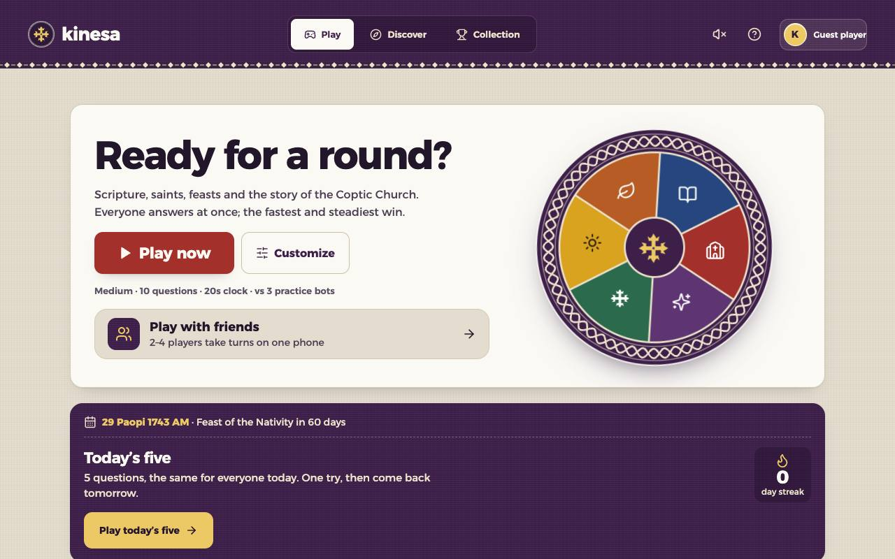

Live UI playground: https://kinesa-playground.kerollos-lowandy.chatgpt.site

# Kinesa ✦

A Coptic and Bible trivia game for teens and adults: solo against practice bots, a daily challenge, or up to four players on one phone. Its look is woven from Coptic tapestry.



[Watch the companion performance close-up](docs/kinesa-companions-motion.webm) · [See the character detail](docs/kinesa-performance.png)

## Run locally

Node.js 20.19+ or 22.12+ is required; Node.js 24 is recommended.

```sh
npm ci
npm run dev
```

Open the address printed by Vite. To build and serve the production version:

```sh
npm run build
npm run preview
```

Deploy `dist/` to any static host at the origin root. The app uses hash navigation and needs no routing rewrites or API keys. Discover and Collection support direct links; unfinished matches can be resumed from the home screen.

## The experience

- **Play now:** one tap starts ten questions against three clearly labeled practice bots. Everyone answers the same question at once: bots think, lock in, and cheer or droop on the reveal. **Customize** (a bottom sheet) sets your name, a category or the mixed wheel, Easy / Medium / Hard, 5 / 10 / 15 questions, and the clock; Play now remembers it.
- **Game feel:** a 20-second countdown ring (15 on Hard; Easy and relaxed play have no clock), streak combos (×1.5 at three in a row, ×2 at five) and a speed bonus of up to +50. Correct answers light up in the category's dye with a small burst; every reveal opens a **Did you know?** note with its source.
- **Play with friends:** two to four players take turns on one phone. A full-screen cover hides each question until the next player is ready, and standings appear after every round. Room codes are a local preview under "Join a room" (sample code `AMEN24`).
- **Today's five:** a daily challenge of five questions from five categories, the same for everyone on a given date. One try a day, a day streak, and streak freezes (earned every seven days, up to two) that cover a missed day.
- **Coptic calendar:** Home shows today's Coptic date (Era of the Martyrs) and the current fast, feast or season — Great Lent, Holy Week, the Holy Fifty Days, the Apostles' Fast, the Nativity Fast and more — computed from the Orthodox Pascha.
- **Progression:** XP and levels, per-category mastery (Bronze 5, Silver 15, Gold 30 correct), a weekly spotlight category worth 1.5× XP, and badge and level-up moments on the results screen. Results show your own placing, a podium, one-tap **Rematch** or another category, and a shareable result image.
- **Discover:** sample questions per category, then **Quiz me on** that category.
- **Collection:** games, correct answers, badges, level and day streak, with mastery on each badge.
- **Companions:** Leo the lion (Mark), Lou the ox (Luke), Juno the eagle (John) and Mattie the human (Matthew) are dealt at random each match and appear as avatars, on the handoff cover and on the podium. They are fictional companions inspired by the traditional Gospel symbols, not portraits of the evangelists.
- **Accessible by default:** keyboard answers (A–D or 1–4), visible focus, AA text colors with a 12px floor, 44px touch targets, reduced-motion paths, sound off by default, and vibration only when sound is on.

## The look: Akhmim tapestry

The visual world comes from Coptic woven tunics (Akhmim tapestry): purple-dyed fields carrying fine linen thread, six dye panels for the categories (woad, madder, purple, green, weld, ochre), undyed-linen reading panes, a clavus band for progress, a roundel wheel with a twelve-point Coptic cross at its center, and Alexandria lettering. There is no glass and no gold. See `PRODUCT.md` for the audience, tone and content rules.

## Questions

The bank lives in `src/content/questions.json`: 125 source-noted questions, at least 20 per category, each with a difficulty, four options, one answer, an explanation and a verifiable source. `npm run validate:questions` (also part of `npm test`) checks unique ids, exactly four distinct options, a single valid answer, explanations, sources and the per-category minimum.

Questions that need a subject-matter check wait in `src/content/review-queue.json` and never ship until they are reviewed and moved into the bank.

## Frontend scope

This is a local frontend preview, not an online service. Practice play uses bots; friends play on one device. There are no accounts, remote rooms or backend. Saved matches (version 2, migrating version 1), progress, preferences and the daily streak live in browser local storage and stay on the device.

## Verification

```sh
npm test                      # question validator + unit tests
npx playwright install chromium
npm run test:e2e              # browser tests (KINESA_PORT overrides port 5173)
npm run play-through          # plays Random, Friends and Today's five at 390×844 and 1280×800
npm run build
```

`npm run play-through` saves a screenshot of every phase to `test-results/play-through/`, probes 360px and 390px layouts for overflow and small text, and fails on any console error. Before-and-after screens for this redesign are in `docs/redesign/`.

## Credits

Original Kinesa artwork and interface; inspired by the friendly category-wheel trivia genre, with no Trivia Crack or Muse assets. React 19, Vite, and Lucide icons (ISC). Alexandria and DM Sans are bundled under the SIL Open Font License in `public/fonts/`.

Screens: [Phone home](docs/redesign/after/phone-random-home.jpg) · [Question](docs/redesign/after/phone-random-question.jpg) · [Feedback](docs/redesign/after/phone-random-feedback-a.jpg) · [Results](docs/redesign/after/phone-random-results-full.jpg) · [Pass the phone](docs/redesign/after/phone-friends-handoff.jpg) · [Today’s five](docs/redesign/after/phone-daily-results-full.jpg) · [Collection](docs/redesign/after/desktop-pages-collection.jpg) · [Before the redesign](docs/redesign/before/)

[Companion performance close-up](docs/kinesa-companions-motion.webm). Regenerate it with `node scripts/capture-companion-performance.mjs` while Vite is running; it enlarges the actual homepage components for a clearer camera view.
